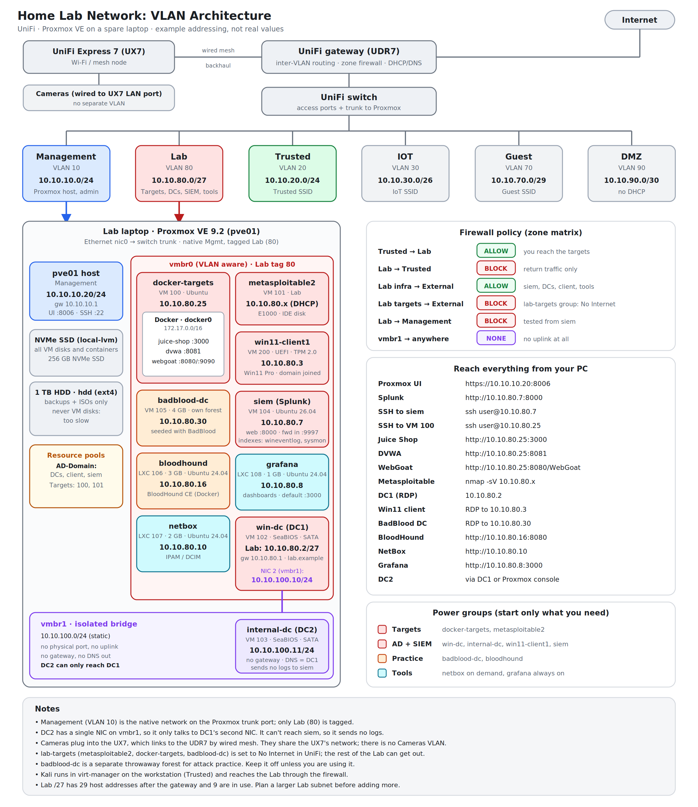

# Proxmox Security Homelab

A VLAN-segmented home lab for security practice, built on one spare laptop running Proxmox VE. It has isolated vulnerable targets, an Active Directory domain with a Windows 11 client, a Splunk SIEM that collects Windows and Sysmon logs, a throwaway domain for attack-path practice with BloodHound, and NetBox and Grafana for documentation and monitoring.

> **Note:** every IP address, hostname, domain and SSID in this repository is an **example**, not a real value.

## What's in the lab

| VM | ID | Network | Purpose |
|---|---|---|---|
| `docker-targets` | 100 | Lab | Ubuntu + Docker running Juice Shop, DVWA and WebGoat |
| `metasploitable2` | 101 | Lab | Classic intentionally vulnerable Linux target |
| `win-dc` (DC1) | 102 | Lab + isolated bridge | Domain controller for the lab domain |
| `internal-dc` (DC2) | 103 | Isolated bridge only | Second domain controller, reachable only through DC1 |
| `siem` | 104 | Lab | Splunk Enterprise |
| `win11-client1` | 200 | Lab | Windows 11 Pro domain client |
| `badblood-dc` | 105 | Lab | Throwaway domain controller in its own forest, seeded with BadBlood |
| `bloodhound` (LXC) | 106 | Lab | BloodHound CE for mapping attack paths in the practice domain |
| `netbox` (LXC) | 107 | Lab | NetBox for the IP, VLAN and device inventory |
| `grafana` (LXC) | 108 | Lab | Grafana dashboards (always on) |

## Design principles

- **Isolation first.** Vulnerable systems live on their own VLAN. The lab can't start connections to trusted or management networks, and the vulnerable targets have no internet access at all.
- **A sealed segment for DC2.** It sits on a bridge with no physical port and no uplink, so the only path in or out is DC1's second NIC.
- **Disposable targets, protected infrastructure.** Targets can be rebuilt in minutes. The DCs and SIEM are backed up.
- **Fit in 16 GB of RAM.** The lab runs in groups (targets, AD + SIEM, or attack practice), never everything at once. Only Grafana stays on.
- **A separate forest for attack practice.** `badblood-dc` is deliberately misconfigured and has nothing to do with the main domain.

## Documentation

Read in this order:

1. [Architecture](docs/01-architecture.md): networks, firewall policy, VM inventory, RAM budget
2. [Proxmox setup](docs/02-proxmox-setup.md): install, VLAN-aware networking, storage, backups
3. [Vulnerable targets](docs/03-vulnerable-targets.md): Docker targets and Metasploitable 2
4. [Active Directory](docs/04-active-directory.md): moving DCs into Proxmox, the isolated bridge, the Windows 11 client
5. [Splunk SIEM](docs/05-splunk-siem.md): install, forwarders, Sysmon, audit policy, searches
6. [Troubleshooting](docs/06-troubleshooting.md): problems I hit and what fixed them
7. [Lessons and roadmap](docs/07-lessons-and-roadmap.md)
8. [Attack practice](docs/08-attack-practice.md): BadBlood domain and BloodHound CE
9. [Lab tools](docs/09-lab-tools.md): NetBox and Grafana in LXC containers

Supporting files: [`configs/`](configs/) (Splunk forwarder inputs) and [`scripts/`](scripts/) (target containers, audit policy, Sysmon).

## Hardware

| Part | Spec |
|---|---|
| Host | Old laptop, 4 cores / 8 threads, 16 GB RAM, Proxmox VE 9.2 |
| VM storage | 256 GB NVMe SSD (LVM-thin) |
| Backups and ISOs | 1 TB hard disk (directory storage) |
| Network | UniFi UDR7 gateway, switch with a trunk port to the host, and a UX7 on wired mesh backhaul |

## Disclaimer

This lab contains **intentionally vulnerable software**. Run it only on networks and systems you own, keep it isolated from anything you care about, and never expose it to the internet. Everything here is for learning.

## Licence

[MIT](LICENSE)
